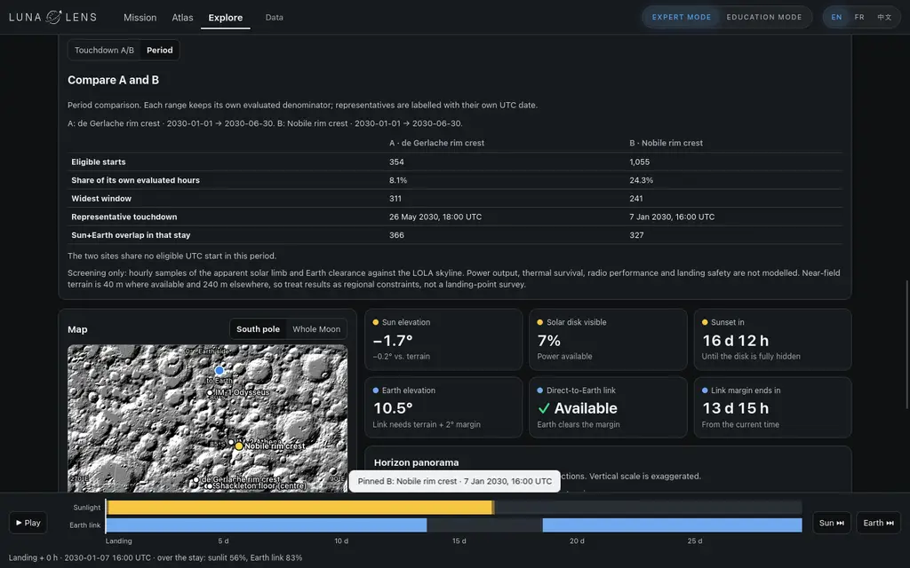
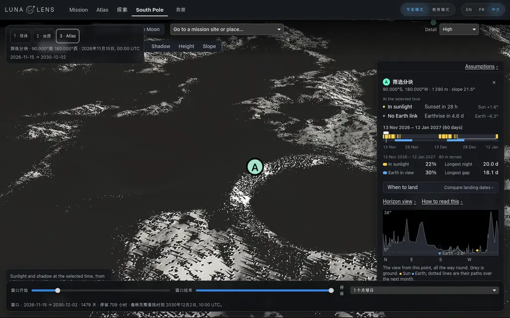
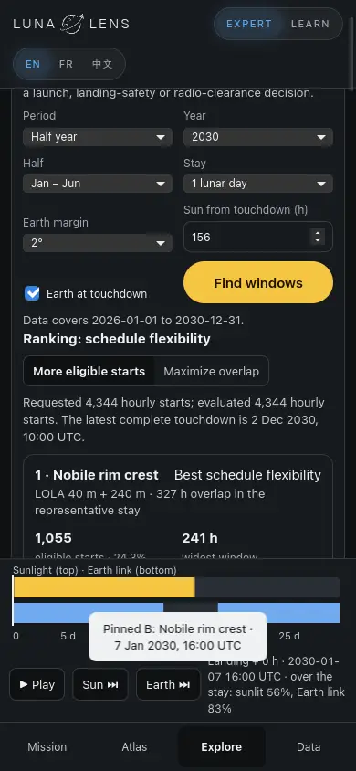

<p align="center">
  
</p>

<h1 align="center">LunaLens</h1>

<p align="center"><strong>Compare Sun and Earth visibility at lunar south-pole landing sites.</strong></p>

<p align="center">
  <a href="https://binggao1230.github.io/LunaLens/"></a>
  <a href="https://github.com/binggao1230/LunaLens"></a>
  <a href="https://www.spaceappschallenge.org/2026/challenges/lunar-landing-site-navigator"></a>
  
  
  
  
</p>

<p align="center">
  <a href="https://binggao1230.github.io/LunaLens/"></a>
</p>

<p align="center"><sub>Map comparison: one current point, saved points, a shared timeline, and a floating Atlas comparison panel.</sub></p>

Submission answers for the NASA Space Apps Challenge 2026 challenge
[Lunar Landing Site Navigator](https://www.spaceappschallenge.org/2026/challenges/lunar-landing-site-navigator).
The product is a browser-based comparison workspace for lunar south-pole landing sites.

- **Project name:** LunaLens
- **Live project:** https://binggao1230.github.io/LunaLens/
- **Source:** https://github.com/binggao1230/LunaLens

> The source repository and live project are public. No login, password or registration is required.

## Project Demonstration

The form asks for a slide deck (maximum 7 slides including title and introduction) or a
video of 30 seconds or less.

**Demo link:** _record the 30-second walkthrough below and paste the public URL here before
submitting. Do not submit a placeholder link._

### 30-second demo path

1. **0–4 s — Windows.** Open the live project in Expert mode. Show the touchdown-window
   finder: period, stay, Earth margin and continuous-sun requirement.
2. **4–9 s — Globe.** Choose a window and confirm it. The Moon shows the selected touchdown
   date, with the Sun and Earth positions for that time.
3. **9–18 s — Map.** Open Map. Click a terrain-backed south-pole point. Show the current
   point's Sun and Earth bars, press **Add to compare**, then add a second point.
4. **18–24 s — Compare.** Show the shared timeline, the long-night bracket, the
   all-sunlit row and the numeric comparison table.
5. **24–28 s — Atlas.** Enter Atlas for the current point. Show the terrain, the four
   layers and the floating comparison sidebar.
6. **28–30 s — Limits.** Close on the project URL and state that LunaLens screens
   geometry, not power, radio performance or landing safety.

If a slide deck is used instead, the same six beats fit in seven slides: title, problem,
Windows, Globe + Map, Compare, Atlas, limits and link.

## Project Summary

LunaLens is a browser-based lunar landing-site explorer for the Moon's south pole. Mission
planners, educators and the public choose a UTC touchdown window, inspect Sun and Earth
positions against the real LOLA terrain skyline, and compare candidate points on a shared
timeline. The Expert flow moves from touchdown-window search to a 3D Globe, a 2D screening
Map and a terrain Atlas; Mission and Education modes explain the same geometry without the
full controls. Users can see when a site is sunlit, when Earth is above the local horizon,
and how a nearby ridge changes both. LunaLens uses JPL Horizons ephemerides and NASA LRO
LOLA terrain, runs entirely in the browser, and states its limits: it is a geometric
screening tool, not a landing-safety, power or radio-link model.

## Project Details

### Screenshots

| Atlas view | Expert mode at 390 px |
|---|---|
|  |  |

The native Expert flow is `Windows → Globe → Map → Atlas`; Mission and Education are
separate entries for classroom and public use.

### What it does

- **Expert flow:** `1 Windows → 2 Globe → 3 Map → 4 Atlas → 5 Explore`.
  Windows searches a UTC period for touchdown dates that meet one set of Sun and Earth
  conditions. Globe confirms the selected window and shows the Moon. Map selects points,
  adds them to a comparison and draws Sun/Earth timelines. Atlas inspects the selected point
  on a terrain map with Sun now, average sunlight, average Earth view and shadow layers.
- **Compare:** up to three saved points share one timeline and one numeric table. A detailed
  comparison opens in a modal with two or three columns and includes sunlight, Earth
  visibility, longest Earth link, longest night, all-points-sunlit time, slope, touchdown
  time and screening status.
- **Mission:** compares terrain-backed sites on one date, with a 3D local view and an
  optional CSV export.
- **Education:** a guided story with an explicitly illustrative verdict, intended to explain
  why a ridge or a date delay changes the result.
- **Languages:** English, French and Chinese interface and glossary.

### How it works

1. **Sun and Earth positions** come from precomputed hourly JPL Horizons data in the
   Moon's mean-Earth frame. The browser interpolates the table and applies the observer's
   position on the surface.
2. **Terrain horizons** come from NASA LRO LOLA polar elevation products. The browser
   traces the local skyline from the selected point; the native screening grid uses the
   240 m raster and selected sites use finer near-field terrain.
3. **Visibility** treats the Sun and Earth as discs rather than points. A site can be
   sunlit while Earth is below the local terrain horizon, or the reverse.
4. **Comparison** uses the same saved-point data for the timeline, table and detailed
   modal. No result is recomputed differently in two panels.
5. **Atlas** is a separate upstream mapping application embedded in the workspace. Its
   data and rendering are not the native LunaLens calculation engine. Attribution and
   redistribution status are recorded below.

### Why it matters

Near the lunar south pole the Sun stays close to the horizon, so a small change in local
terrain can decide whether a site has power and whether Earth is visible for a direct link.
LunaLens makes that trade-off visible without requiring a GIS workstation. It is intended
for rapid screening and explanation, not for certifying a landing site.

### Tools and languages

- **Front end:** HTML, CSS and vanilla JavaScript; Three.js, OrbitControls and GLTFLoader
  for the 3D views; no UI framework in the native app.
- **Data processing:** Python scripts turn provider products into browser-sized tables and
  grids; a Python reference implementation checks the browser visibility rules.
- **Atlas:** React/Vite build of the upstream `daniel27-space/lunar-navigator`, served in a
  same-origin frame.
- **Delivery:** GitHub Actions builds Atlas and publishes `site/` to GitHub Pages; the older
  Cloudflare Workers deployment remains available.
- **Testing:** `check_js.mjs`, `check_team.mjs`, `check_grid.mjs`, `check_search.mjs` and a
  Python ephemeris/SVS check.

### Creativity and design choices

- One shared clock and one shared comparison model across Map and Atlas.
- A timeline that shows Sun and Earth windows, the longest night and all-points-sunlit time
  on the same strip.
- A floating, collapsible Atlas sidebar so the terrain stays visible while comparing.
- An Education mode that deliberately separates the illustrative teaching verdict from the
  scientific screening result.

### Limits

LunaLens does **not** calculate power output, thermal survival, radio performance, launch
windows, landing safety or certified mission coordinates. The 80 m and 240 m terrain
products constrain regional terrain, not exact landing-point values. Atlas is a separate
upstream build; do not present its features as native LunaLens work.

## Use of Super Intelligence

**Selected in the form:** `Coding, Debugging, or Troubleshooting` and
`Writing, Editing, or Translation`.

**Where and how SI was used:**

- implementation planning and architecture discussions;
- application code and data-processing scripts;
- debugging and consistency checks;
- documentation, interface copy and English/French/Chinese translation.

**What was not generated:**

- the scientific ephemeris and terrain products are provider data, not model output;
- the browser performs deterministic geometry on those inputs;
- the project does not knowingly include SI-generated images, audio or video;
- no NASA logo, flag, mission identifier or other NASA branding was generated or modified.

The Education verdict is explicitly illustrative and must not be read as a NASA result.
Team members must confirm this disclosure and all visual credits against the final release.

## NASA Data

| Link Text | Link URL |
|---|---|
| JPL Horizons — Sun and Earth ephemerides | https://ssd.jpl.nasa.gov/horizons/ |
| NASA LRO LOLA — polar elevation products (LDEM_75S_240M, LDEM_85S_40M) | https://pds-geosciences.wustl.edu/missions/lro/lola.htm |
| NASA GSFC PGDA product 69 — long-term illumination, Earth visibility and permanent shadow | https://pgda.gsfc.nasa.gov/products/69 |
| NASA GSFC PGDA product 78 — LOLA south-pole terrain used by Atlas | https://pgda.gsfc.nasa.gov/products/78 |
| NASA SVS 5587 — Moon Phase and Libration 2026, independent ephemeris check | https://svs.gsfc.nasa.gov/5587 |
| NASA Earth Observatory Blue Marble — Earth texture used by Atlas | https://earthobservatory.nasa.gov/features/BlueMarble |
| NASA/GSFC/Arizona State University LROC — mission imagery and maps in Atlas | https://www.lroc.asu.edu/ |

The native app also records its exact product names and processing in
`site/data/PROVENANCE.json`. Atlas records per-layer citations in
`site/atlas/data/layers/layers.json` and per-mission credits in
`site/atlas/data/missions.json`.

## Space Agency Partner and Other Data

| Link Text | Link URL |
|---|---|
| daniel27-space/lunar-navigator — upstream Atlas application (Apache-2.0) | https://github.com/daniel27-space/lunar-navigator |
| Three.js, OrbitControls, GLTFLoader — 3D rendering (MIT) | https://threejs.org/ |
| Draco mesh decoder — compressed geometry (Apache-2.0) | https://github.com/google/draco |
| noUiSlider — range controls (MIT) | https://refreshless.com/nouislider/ |
| Geist and Geist Mono — interface fonts (SIL Open Font License 1.1) | https://vercel.com/font |
| Mission coordinate and historical source links | `site/data/sites.json` and `site/atlas/data/missions.json` |
| Wikipedia, where cited for mission history | https://www.wikipedia.org/ (CC BY-SA 4.0) |

The Atlas build keeps its own [`LICENSE`](site/atlas/LICENSE) and upstream README. Its
redistribution and attribution must be confirmed before a judged release; see
[`doc/PORT_PLAN.md`](doc/PORT_PLAN.md). The native LunaLens code and text are the team's
original work.

## Project Submission Verification

- The live project is public and requires no login: https://binggao1230.github.io/LunaLens/
- All external scientific data, code, fonts and libraries used by the release are listed
  above or in the provenance files named above.
- Third-party licences are kept with their assets: Atlas Apache-2.0, Three.js MIT, Draco
  Apache-2.0, noUiSlider MIT, Geist SIL OFL 1.1.
- The project does not claim NASA endorsement. NASA, JPL, LRO, LOLA, PGDA and LROC names
  identify data sources only.
- The demo link must be recorded and checked in an anonymous browser before submission.
- The authorised team member must submit the project separately from deploying it.

## Run Locally

`site/` is the product. There is no build step for the native app. The native snapshot is
kept out of Git; restore it before serving:

```sh
lunalens_snapshot_dir="$(mktemp -d)"
gh release download lunalens-snapshot-2026-11-14 \
  --pattern 'lunalens.zip.part*' --pattern 'restore-lunalens.py' --pattern 'lunalens-files.json' \
  --dir "$lunalens_snapshot_dir"
python3 "$lunalens_snapshot_dir/restore-lunalens.py"
mkdir -p site/data
cp -a "$lunalens_snapshot_dir/lunalens/site/data/." site/data/
python3 site/tools/serve.py 8768
```

Open `http://localhost:8768/`. The server binds `0.0.0.0`, so a phone on the same network
can use the machine's LAN address.

## Checks

```sh
node site/tools/check_search.mjs
node site/tools/check_grid.mjs
node site/tools/check_js.mjs
node site/tools/check_team.mjs
python3 site/tools/check_ephemeris_svs.py
```

`check_js.mjs` and `check_team.mjs` need a Python interpreter on `PATH` (or the backend
venv). Records for the current run are in `TODO.md` under `Run log`.

## Online Deployment

- **GitHub Pages:** https://binggao1230.github.io/LunaLens/ — public, built by
  `.github/workflows/pages.yml` on every push to `main`.
- **Cloudflare Workers:** https://luna-lens.gaobing1230.workers.dev — built by
  `.github/workflows/deploy.yml`.

Both workflows download the snapshot release, build Atlas and publish `site/`.

## Repository Map

| Path | Use |
|---|---|
| `site/` | the product; `site/data/` is not in Git |
| `site/js/engine/` | ephemeris, DEM, skyline, geometry and metrics |
| `site/js/views/` | Mission, Education, Expert, Map and Atlas integration |
| `site/atlas/` | upstream Atlas build and its attribution |
| `backend/` | Python reference for the visibility and window rules |
| `doc/` | challenge text, submission draft and Atlas integration note |
| `TODO.md` | implementation plan, acceptance checks and run log |
| `AGENTS.md`, `CONTRIBUTING.md` | project rules and Git workflow |

## Contributing

Nobody commits to `main` directly. Branch, push and open a pull request:

```sh
git switch main && git pull
git switch -c <your-name>/<short-topic>
# ... work ...
git push -u origin <your-name>/<short-topic>
```

See [CONTRIBUTING.md](CONTRIBUTING.md) for checks and review.
