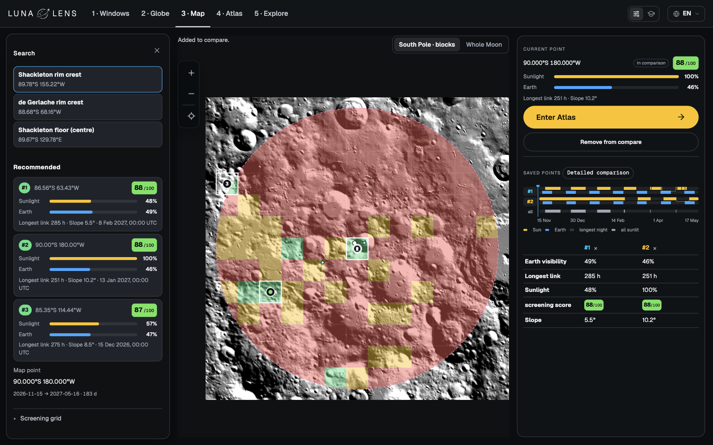
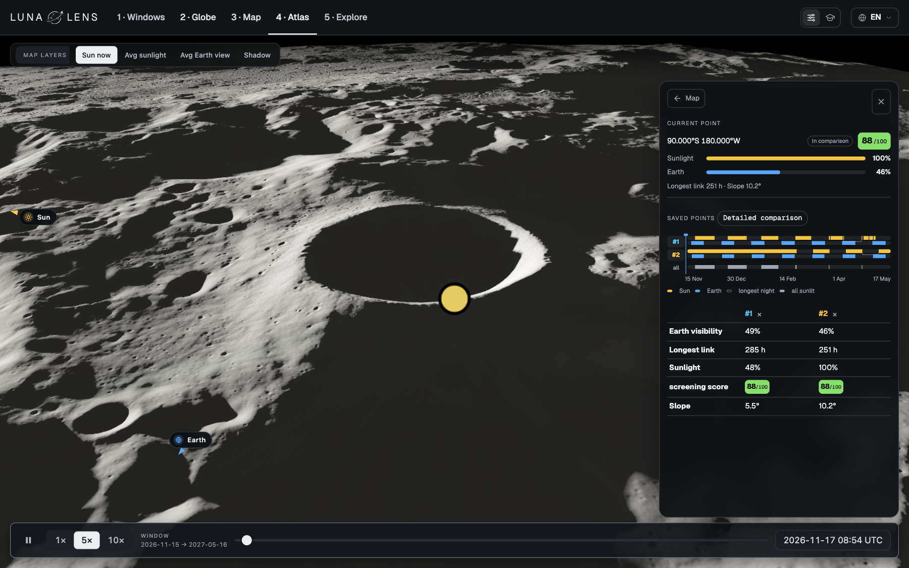
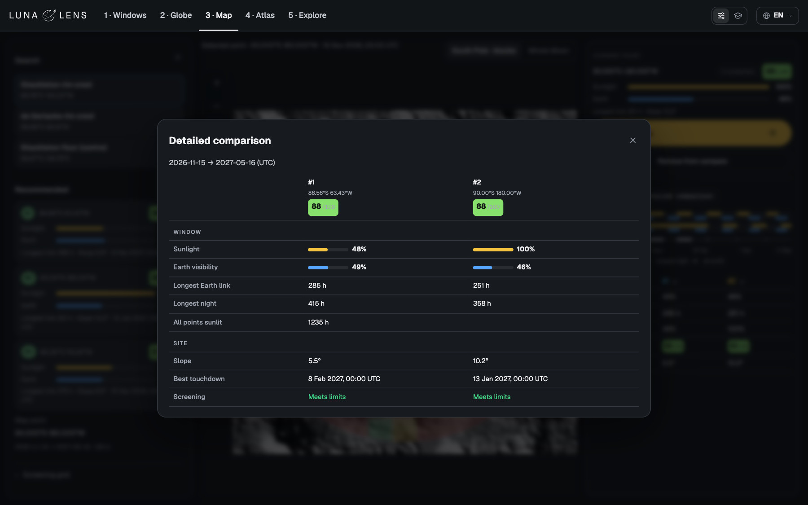
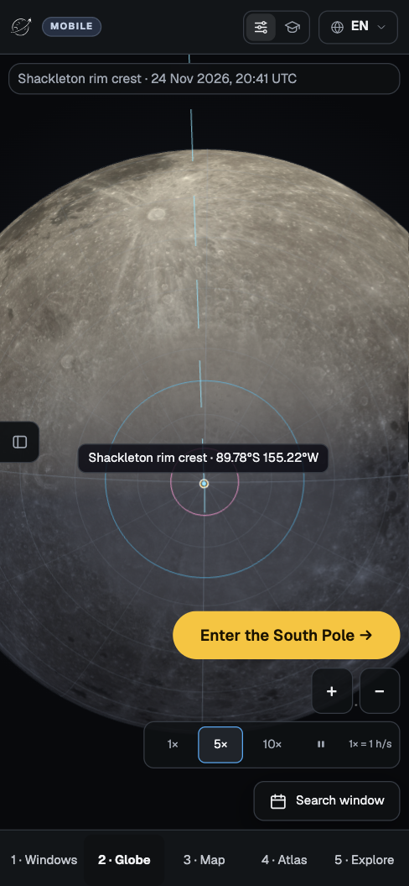
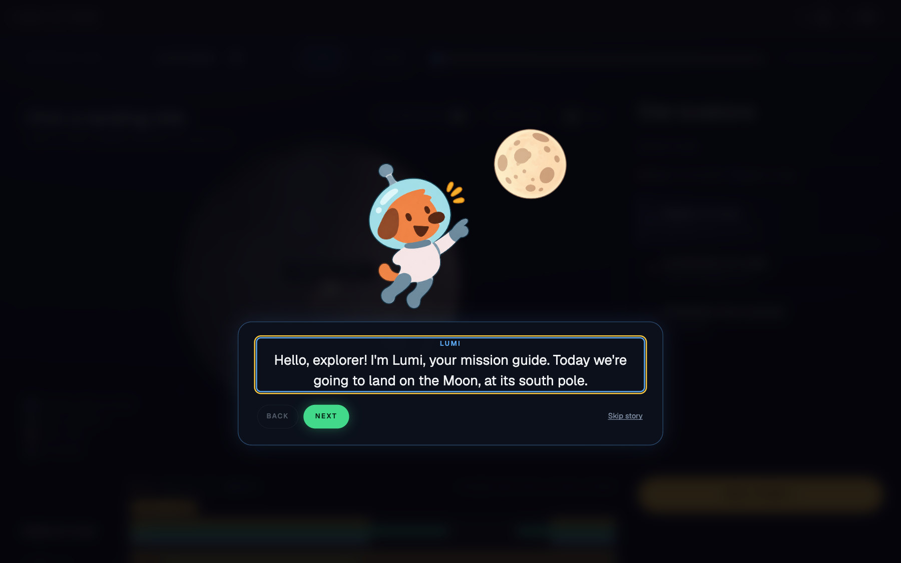

<p align="center">
  
</p>

<h1 align="center">LunaLens</h1>

<p align="center"><strong>Compare Sun and Earth visibility at lunar south-pole landing sites.</strong></p>

<p align="center">
  <a href="https://binggao1230.github.io/LunaLens/"></a>
  <a href="https://drive.google.com/file/d/1ADRdtMhWl3E4a7Gwni7cMtdsIJp8bd-s/view"></a>
  <a href="https://github.com/binggao1230/LunaLens"></a>
  <a href="https://www.spaceappschallenge.org/2026/challenges/lunar-landing-site-navigator"></a>
  
  
  
</p>

<p align="center">
  <a href="https://binggao1230.github.io/LunaLens/"></a>
</p>

<p align="center"><sub>Map comparison: one current point, a saved comparison set, a shared timeline, and a floating Atlas panel.</sub></p>

LunaLens is a browser-based workspace for exploring lighting and direct-to-Earth
visibility at lunar south-pole landing sites. It combines JPL Horizons ephemerides with
NASA LRO LOLA terrain, then exposes the result as a 3D globe, a screening map and a terrain
Atlas.

The app is a geometric screening tool. It does not calculate power output, thermal
survival, radio performance, launch windows or landing safety.

**[Live app](https://binggao1230.github.io/LunaLens/)** ·
**[30-second demo](https://drive.google.com/file/d/1ADRdtMhWl3E4a7Gwni7cMtdsIJp8bd-s/view)**

## Overview

A landing site near the south pole is shaped by two questions at once: is the surface
sunlit, and is Earth above the local terrain horizon? LunaLens makes both visible on the
same clock and the same comparison surface.

The Expert workflow is deliberately narrow:

```text
1 Windows → 2 Globe → 3 Map → 4 Atlas → 5 Explore
```

- **Windows** searches a UTC period for touchdown dates that satisfy one set of Sun,
  Earth and stay conditions.
- **Globe** confirms the selected window and places the Moon at that time.
- **Map** selects points and builds a comparison set of up to three saved points.
- **Atlas** inspects the active point on terrain with Sun now, average sunlight, average
  Earth view and shadow layers.
- **Mission** and **Education** offer a shorter, guided path through the same geometry.

## Features

- **Touchdown-window search** across a day, half-year, year or custom UTC range.
- **Terrain-backed horizons** from LOLA polar elevation products; custom points fall back
  to the 240 m regional grid.
- **3D Moon** with real Sun and Earth directions, local relief and a movable time clock.
- **Point comparison** with a shared Sun/Earth timeline, longest-night bracket and
  all-points-sunlit row.
- **Responsive mobile layout** with touch-sized controls, safe-area-aware navigation and
  the same Expert flow down to 390 px.
- **Detailed comparison** in a two- or three-column modal for saved points.
- **Floating Atlas panel** with a collapsible comparison sidebar and a back-to-Map action.
- **Mission view** for terrain-backed sites, with a 3D local scene and CSV export.
- **Education mode** with a guided story and an explicitly illustrative verdict.
- **English, French and Chinese** interfaces and glossary.

## Screenshots

### Map comparison


### Atlas



### Detailed comparison



### Mobile

<p align="center"></p>

The phone layout keeps the selected site, time readout, zoom, time speed and the
`Enter the South Pole` action within thumb reach, with the five-step Expert navigation
fixed to the bottom edge.

### Education



Education mode opens with Lumi, a mission guide, and a short story that explains the same
Sun, Earth and terrain geometry with an explicitly illustrative verdict.

All screenshots are English and show the current release.

## How it works

1. **Ephemerides.** Hourly JPL Horizons Sun and Earth positions in the Moon's mean-Earth
   frame are precomputed into a small browser table. The client interpolates the table and
   applies the observer's position on the surface.
2. **Terrain horizons.** NASA LRO LOLA elevation grids provide the local skyline. The
   browser traces the horizon from the selected point; the screening grid uses the 240 m
   raster and selected sites use finer near-field terrain.
3. **Visibility.** The Sun and Earth are treated as discs, not points. A site can be
   sunlit while Earth is below the terrain horizon, or the reverse.
4. **Comparison.** Saved points share one clock, one timeline and one table. The detailed
   modal uses the same underlying metrics.
5. **Atlas.** Atlas is a separate upstream mapping application embedded in the workspace.
   Its data and rendering are not the native LunaLens calculation engine.

## Data and accuracy

| Source | Use |
|---|---|
| [JPL Horizons](https://ssd.jpl.nasa.gov/horizons/) | Hourly Sun and Earth positions, DE441 |
| [NASA LRO LOLA](https://pds-geosciences.wustl.edu/missions/lro/lola.htm) | Polar elevation products and derived skylines |
| [NASA GSFC PGDA product 69](https://pgda.gsfc.nasa.gov/products/69) | Long-term sunlight, Earth view and permanent shadow |
| [NASA GSFC PGDA product 78](https://pgda.gsfc.nasa.gov/products/78) | South-pole terrain used by Atlas |
| [NASA SVS 5587](https://svs.gsfc.nasa.gov/5587) | Independent 2026 ephemeris check |
| [NASA SVS 4720](https://svs.gsfc.nasa.gov/4720) | LROC lunar color texture |
| [NASA GIBS](https://gibs.earthdata.nasa.gov/) | Blue Marble Earth texture |
| [NASA SDO/AIA](https://sdo.gsfc.nasa.gov/) | Solar disc texture |
| [NASA Apollo 8 Earthrise](https://images.nasa.gov/details/as08-14-2383) | Landing-page background |

The native app records its exact product names and processing in
[`site/data/PROVENANCE.json`](site/data/PROVENANCE.json). Atlas records per-layer citations
in [`site/atlas/data/layers/layers.json`](site/atlas/data/layers/layers.json) and mission
credits in [`site/atlas/data/missions.json`](site/atlas/data/missions.json).

Accuracy limits: an 80 m or 240 m terrain product constrains regional terrain, not exact
landing-point values. The interface states that the result is not a certified landing
survey.

## Run locally

`site/` is the product. There is no build step for the native app. The native snapshot is
kept out of Git; restore it before serving:

```sh
lunalens_snapshot_dir="$(mktemp -d)"
gh release download lunalens-snapshot-2026-11-14 \
  --pattern 'lunalens.zip.part*' --pattern 'restore-lunalens.py' --pattern 'lunalens-files.json' \
  --dir "$lunalens_snapshot_dir"
python3 "$lunalens_snapshot_dir/restore-lunalens.py"
mkdir -p site/data
cp -a "$lunalens_snapshot_dir/lunalens/site/data/." site/data/
python3 site/tools/serve.py 8768
```

Open `http://localhost:8768/`. The server binds `0.0.0.0`, so a phone on the same network
can use the machine's LAN address.

## Checks

```sh
node site/tools/check_search.mjs
node site/tools/check_grid.mjs
node site/tools/check_js.mjs
node site/tools/check_team.mjs
python3 site/tools/check_ephemeris_svs.py
```

`check_js.mjs` and `check_team.mjs` need a Python interpreter on `PATH` (or the backend
venv). Pre-submission checks:

```sh
node site/tools/preflight.mjs
```

## Deployment

GitHub Pages is the public deployment:
https://binggao1230.github.io/LunaLens/

The workflow at [`.github/workflows/pages.yml`](.github/workflows/pages.yml) downloads the
snapshot release, builds Atlas and publishes `site/` on every push to `main`.

## Repository map

| Path | Use |
|---|---|
| `site/` | the product; `site/data/` is not in Git |
| `site/js/engine/` | ephemeris, DEM, skyline, geometry and metrics |
| `site/js/views/` | Mission, Education, Expert, Map and Atlas integration |
| `site/atlas/` | upstream Atlas build and attribution |
| `backend/` | Python reference for the visibility and window rules |
| `doc/` | challenge text, submission answers and Atlas integration note |
| `TODO.md` | implementation plan, acceptance checks and run log |
| `AGENTS.md`, `CONTRIBUTING.md` | project rules and Git workflow |

## Third-party code and assets

- [daniel27-space/lunar-navigator](https://github.com/daniel27-space/lunar-navigator) —
  upstream Atlas application, Apache-2.0.
- [Three.js](https://threejs.org/), OrbitControls and GLTFLoader — 3D rendering, MIT.
- [Draco](https://github.com/google/draco) — compressed geometry, Apache-2.0.
- [noUiSlider](https://refreshless.com/nouislider/) — range controls, MIT.
- [Geist and Geist Mono](https://github.com/vercel/geist-font) — interface fonts, SIL OFL 1.1.
- 3D model credits and licence notes: [`site/assets/models/README.md`](site/assets/models/README.md).

The native LunaLens code and text are the team's original work. Atlas is an attributed
upstream project and must not be presented as native LunaLens work. The native code
licence has not yet been selected.

## Contributing

Nobody commits to `main` directly. Branch, push and open a pull request:

```sh
git switch main && git pull
git switch -c <your-name>/<short-topic>
# ... work ...
git push -u origin <your-name>/<short-topic>
```

See [CONTRIBUTING.md](CONTRIBUTING.md) for checks and review.
